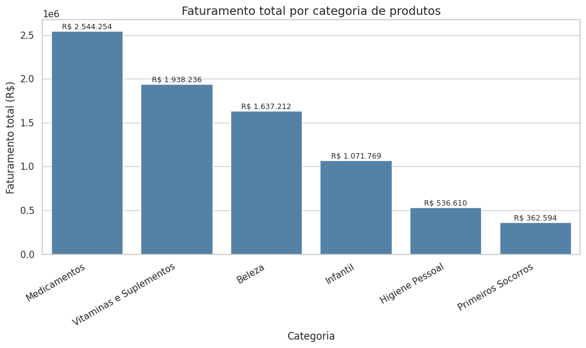
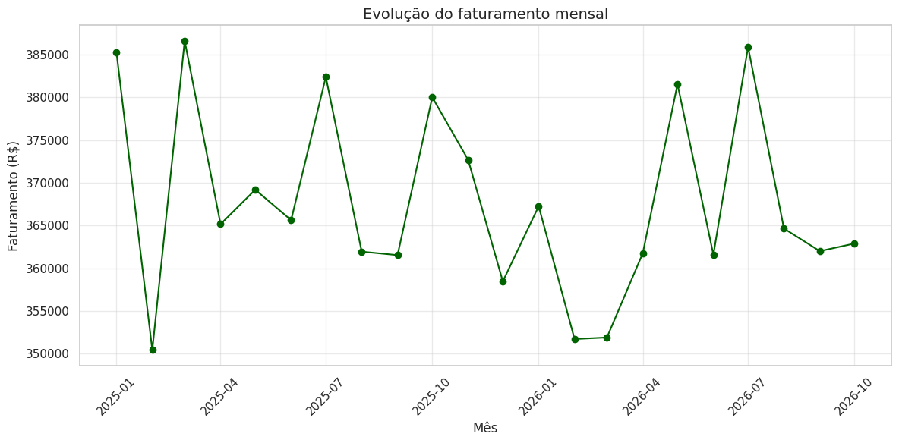
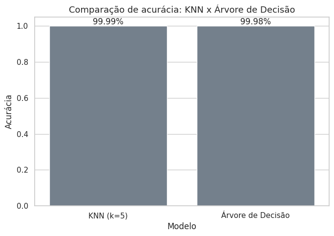

# Rede de Farmácias Vida+ — Análise de Vendas e Classificação com Machine Learning

Estudo de caso em Python com **50.000 vendas** de uma rede de farmácias do Distrito Federal. Analisei o faturamento por categoria e ao longo do tempo e treinei dois modelos de classificação, **KNN** e **Árvore de Decisão**, para prever se uma venda é de **Alto** ou **Baixo Valor**.

> Projeto da disciplina Desenvolvimento para Ciência de Dados I — Bacharelado em Ciência de Dados e Machine Learning (UniCEUB).

**Fluxo:** IMPORTAR → VISUALIZAR → MODELAR → AVALIAR → CONCLUIR

## Destaques

- Analisei cerca de **R$ 8,1 milhões** em vendas, de jan/2025 a out/2026.
- **Medicamentos** lideram o faturamento, com R$ 2,54 milhões (31% do total).
- O faturamento mensal é estável, entre **R$ 350 mil e R$ 387 mil**.
- O KNN chegou a **99,99%** de acurácia e a Árvore de Decisão a **99,98%**, no mesmo conjunto de teste de 15.000 vendas.

## Dados

O arquivo `data/farmacias_vida_50k.csv` tem 50.000 linhas e 12 colunas:

| Coluna | Descrição |
| --- | --- |
| `id_venda`, `data_hora` | identificação e momento da venda |
| `filial`, `cidade` | unidade da rede e cidade |
| `produto`, `categoria` | item vendido e sua categoria |
| `quantidade`, `preco_unitario`, `desconto_valor`, `valor_liquido` | valores da venda |
| `forma_pagamento` | PIX, cartão, dinheiro etc. |
| `classe_venda` | **variável-alvo**: `Alto Valor` (14.153) ou `Baixo Valor` (35.847) |

## Análise exploratória

| Faturamento por categoria | Evolução mensal |
| --- | --- |
|  |  |

- **Ranking de categorias:** Medicamentos (R$ 2,54 mi), Vitaminas e Suplementos (R$ 1,94 mi), Beleza (R$ 1,64 mi), Infantil (R$ 1,07 mi), Higiene Pessoal (R$ 0,54 mi) e Primeiros Socorros (R$ 0,36 mi).
- **Tendência no tempo:** não há sazonalidade forte, e o faturamento varia menos de 10% de um mês para outro.

## Machine Learning

- **Entradas (X):** `quantidade` e `preco_unitario`
- **Alvo (y):** `classe_venda`
- **Divisão:** 70% treino (35.000) / 30% teste (15.000), com `stratify=y` para manter a proporção das classes e `random_state=42` para reprodutibilidade

| Modelo | Acurácia (teste) |
| --- | --- |
| KNN (k = 5) | **99,99%** |
| Árvore de Decisão | 99,98% |



### Interpretação

O KNN teve a maior acurácia, mas a diferença para a Árvore de Decisão é mínima. As acurácias são tão altas porque a `classe_venda` é definida a partir do valor da venda, que vem de `quantidade × preco_unitario`. Ou seja, as variáveis de entrada praticamente determinam o alvo, e os dois modelos conseguem aprender essa regra.

Como próximos passos, quero testar o modelo em um cenário mais realista, com variáveis que não definem o alvo diretamente (categoria, filial, forma de pagamento, horário), e avaliar outras métricas além da acurácia, como matriz de confusão, precisão e recall.

## Tecnologias

- Python 3
- Pandas (manipulação, `groupby`, séries temporais com `to_period`)
- Matplotlib e Seaborn (visualização)
- Scikit-learn (`train_test_split`, `KNeighborsClassifier`, `DecisionTreeClassifier`, `accuracy_score`)
- Jupyter Notebook

## Estrutura do repositório

```
analise-farmacias-vida-ml/
├── farmacias_vida_ml.ipynb   # notebook com análise, modelos e conclusão
├── data/
│   └── farmacias_vida_50k.csv
├── images/                   # gráficos exportados do notebook
└── requirements.txt
```

## Como executar

```bash
git clone https://github.com/vitorcalasans-tech/analise-farmacias-vida-ml.git
cd analise-farmacias-vida-ml
pip install -r requirements.txt
jupyter notebook farmacias_vida_ml.ipynb
```

## Autor

**Vítor Calasans** — estudante de Ciência de Dados e Machine Learning (UniCEUB)
[github.com/vitorcalasans-tech](https://github.com/vitorcalasans-tech)
